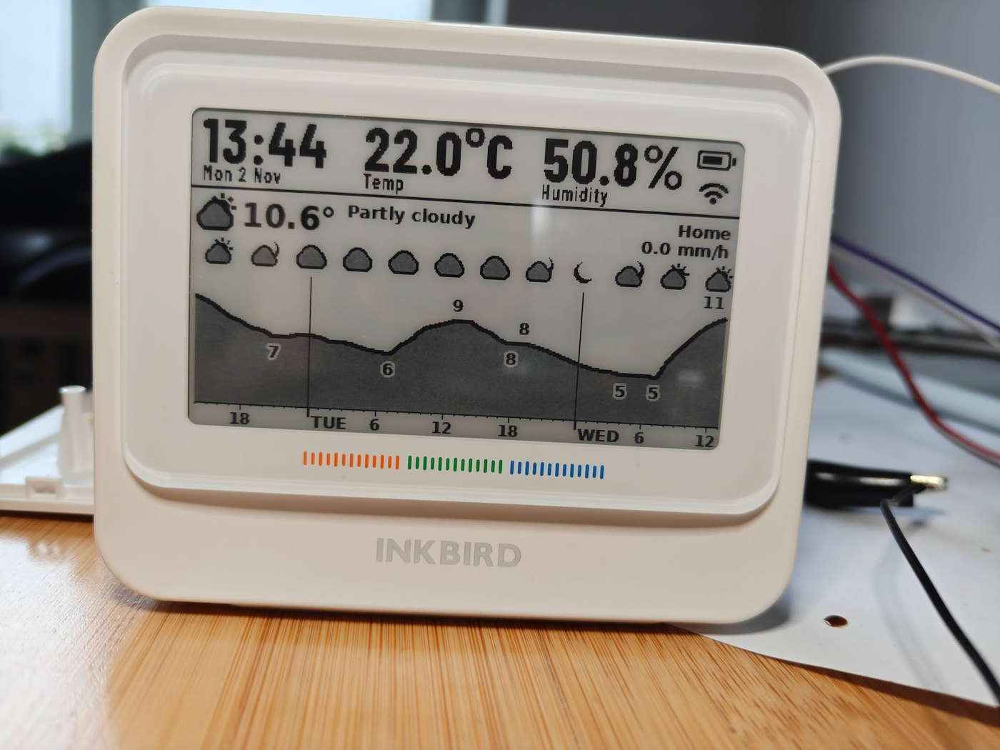
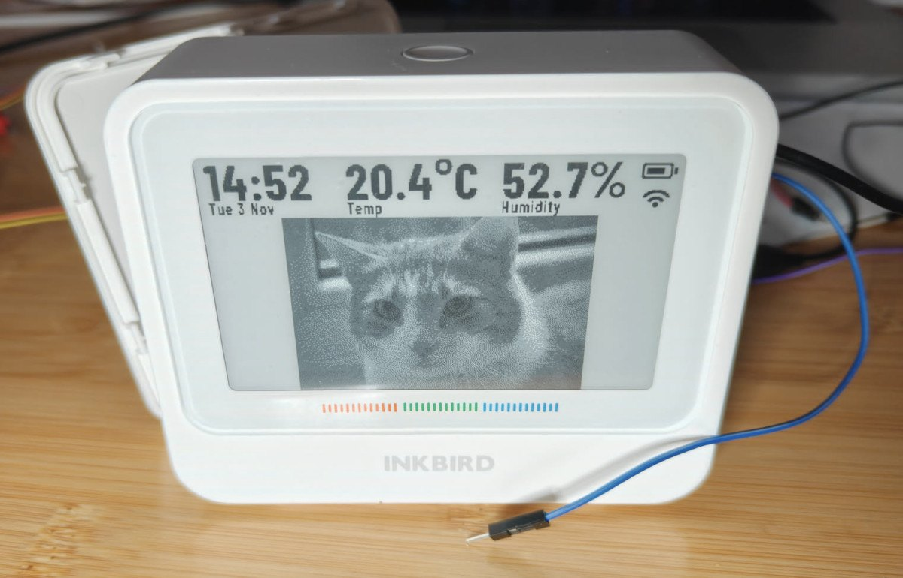
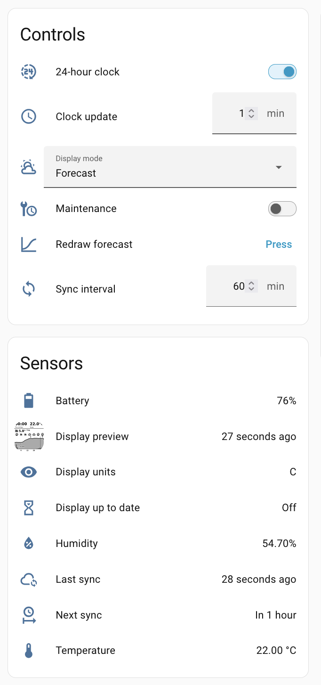
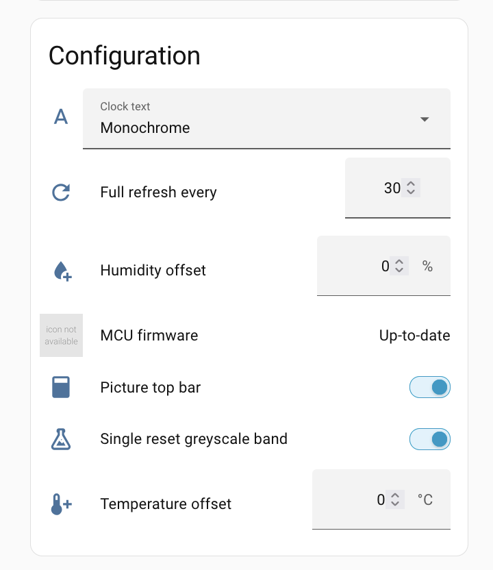
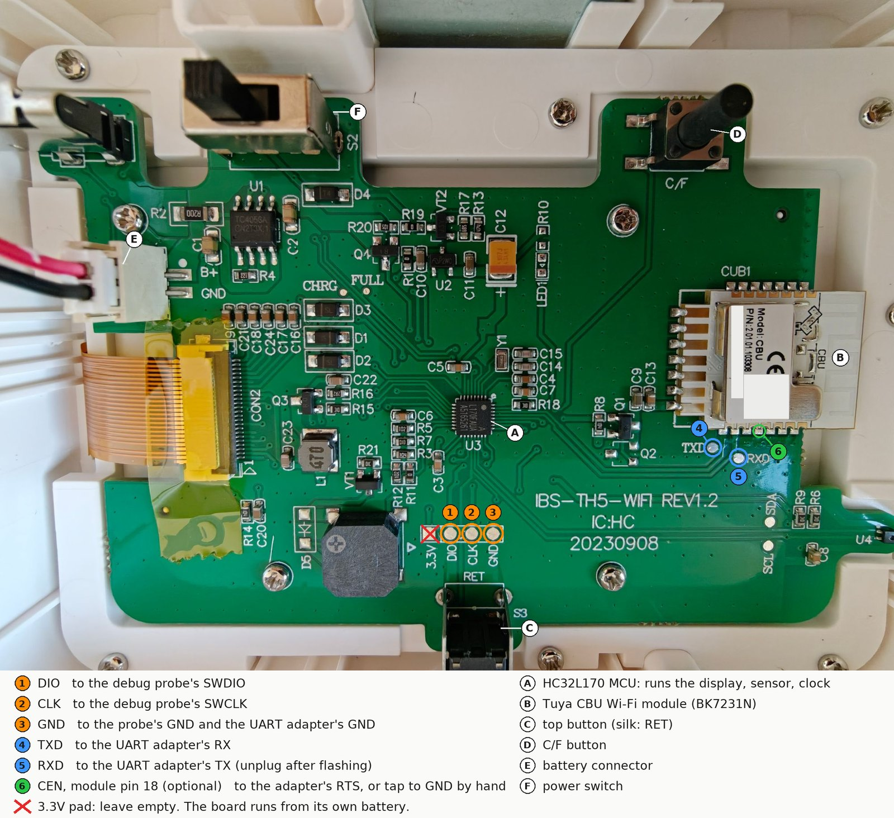
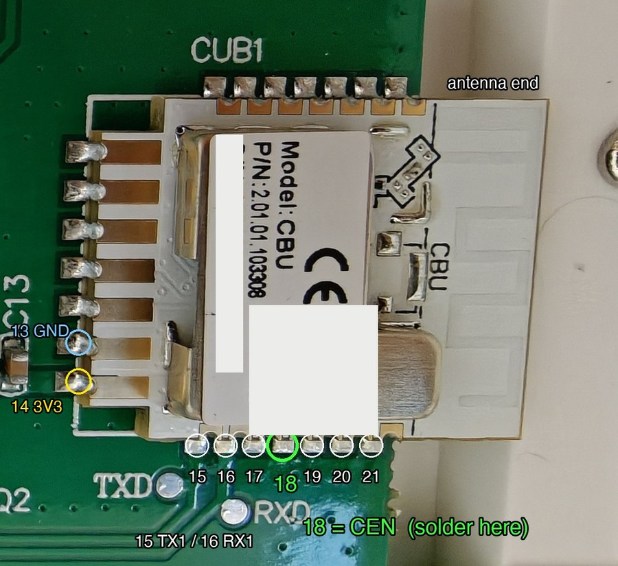
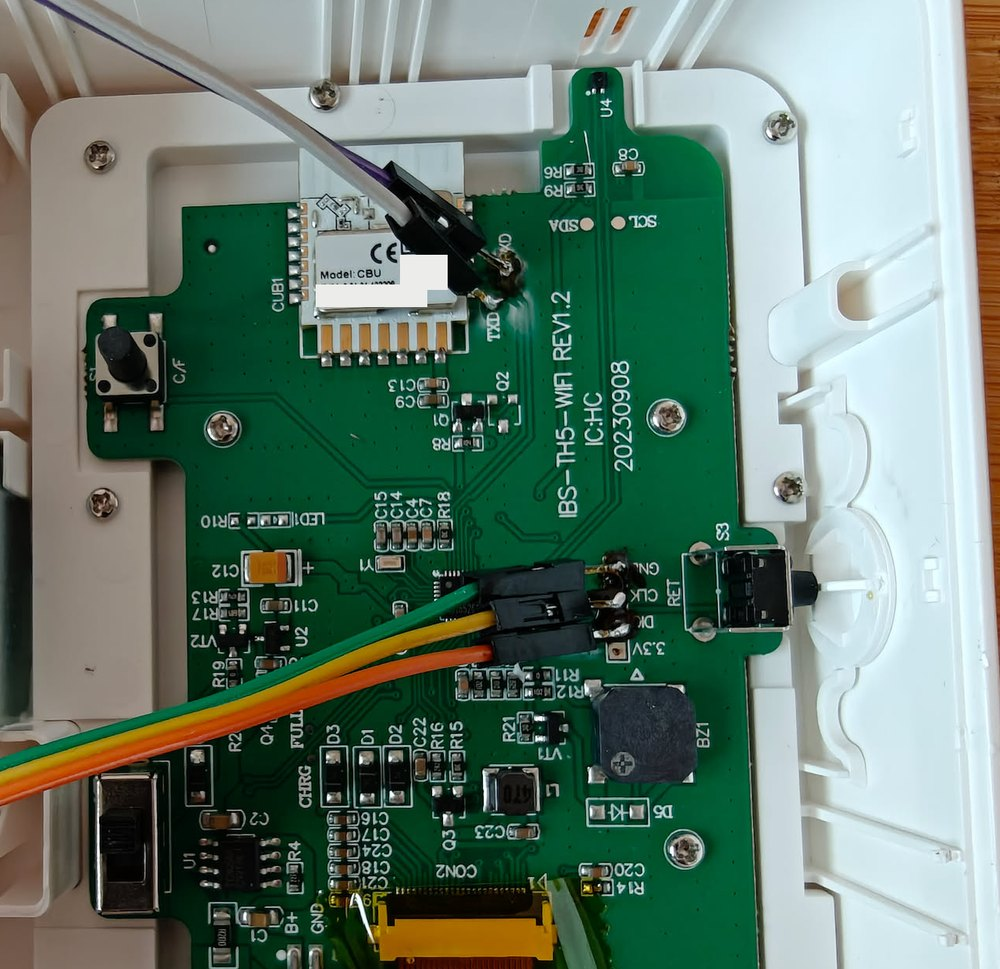
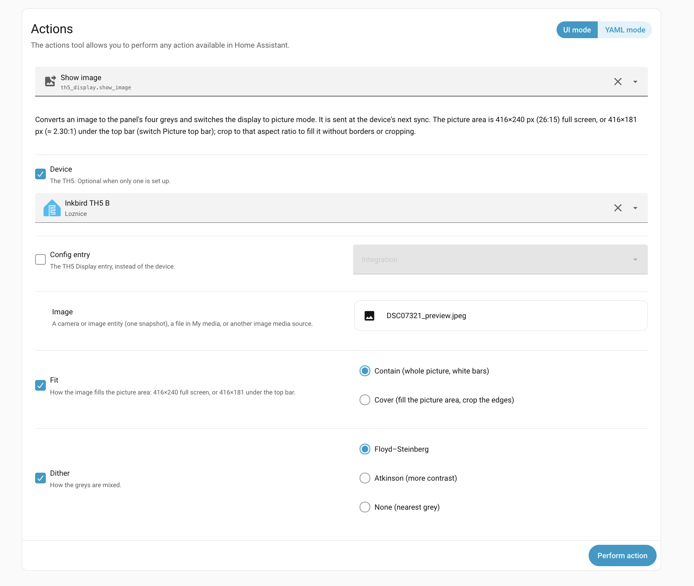

# Local firmware for the Inkbird IBS-TH5-WIFI (Home Assistant, no cloud)

Replacement firmware for both chips of the **Inkbird IBS-TH5-WIFI** e-paper thermo-hygrometer, plus a Home Assistant integration. The device becomes a battery-powered e-paper display driven by Home Assistant: a clock with indoor temperature and humidity on top, and below it either a 48-hour weather forecast or any picture you send it. No Inkbird app, no Tuya cloud.

| Forecast | Picture |
|---|---|
|  |  |

> ### AI Slop disclaimer
> Everything in this repository was generated by an AI (Claude): both firmwares, the Home Assistant integration, the flashing tools, the reverse engineering it is based on, the tests, the annotated pictures and this README. A human supervised, soldered and pressed the buttons, but did not write or line-by-line review the code.
>
> It runs on exactly two units (same board revision), in daily use under one Home Assistant install. The second unit was set up with the steps below; the first one is where they were worked out.
>
> What that means for you: two units are the whole test fleet. Your board revision or stock firmware may differ, you can brick either chip, the device is powered by a lithium cell, battery life has never been measured (quick optimizations were done, it seems to be fine so far!), and nobody will support you. **Take both backups first, and read what a command does before you run it.** No warranty of any kind.

You are expected to do this with an LLM coding assistant at your side (that is how it was made). The repo is small on purpose so that an assistant can read all of it.

## What you get

- **On the device:** a top bar drawn by the device itself and updated every minute (clock, date, indoor temperature and humidity, battery and Wi-Fi icons). Under it, a frame rendered by Home Assistant in four greys: a 48 h forecast chart from any HA weather entity, or a picture (full screen, or under the top bar).
- **In Home Assistant:** temperature, humidity, battery, an hourly min/mean/max statistic of both, and controls for the display mode, sync interval, clock format, offsets and so on. A preview image shows what the panel shows.
- **Updates over Wi-Fi** for both chips after the first flash: the MCU firmware from an *Update* entity in HA, the Wi-Fi module with ESPHome's normal OTA.

 

Not done or not verified: battery life is unmeasured (a sync every 60 min and a clock update every minute are the defaults; both are adjustable). The low-battery "charge me" screen and cutoff have never been seen on a real low battery. The stock alarms, the comfort indicator and the Inkbird app are gone.

## How it works, in one paragraph

The board has two chips. An **HC32L170** microcontroller runs the e-paper panel, the SHT40 sensor, the clock and the buttons, and it switches the power of a **Tuya CBU** Wi-Fi module (BK7231N) on only for a few seconds per sync. We replace both firmwares: the HC32 gets our own bare-metal firmware ([firmware/](firmware/)), the CBU gets ESPHome with a custom component ([esphome/](esphome/)) that talks to the HC32 over the UART between them. At each sync the module joins Wi-Fi, dials Home Assistant, reports the readings, and the HA integration ([custom_components/th5_display/](custom_components/th5_display/)) answers with the time, the settings and, if it changed, a new 25 KB frame. Then the radio goes off again. Home Assistant does the rendering; the device only stores and shows frames.

## What you need

- The thermometer: board marked **`IBS-TH5-WIFI REV1.2`** (2023-09-08), with a `CBU` module and an `L170FAUA` chip. Anything else is unknown territory.
- An **SWD debug probe** that pyOCD supports (CMSIS-DAP). Tested with a Raspberry Pi Debug Probe.
- A **3.3 V USB-UART adapter** (tested with a CH343-based one). Never connect its VCC pin. The Debug Probe's UART port may work too, but then you have no RTS line and reset the module by hand.
- Soldering iron, thin wire, a few Dupont jumpers, optionally a 3-pin 2.54 mm header.
- A computer with:
  - [uv](https://docs.astral.sh/uv/) (runs the Python tools and ESPHome),
  - `pyocd` 0.46 and `ltchiptool` 4.15: `uv tool install pyocd==0.46.0`, `uv tool install ltchiptool==4.15.0` (then `uv tool update-shell` if they are not on your PATH),
  - the HC32 device pack for pyOCD: `pyocd pack install hc32l170faua`,
  - an `arm-none-eabi-gcc` toolchain (tested with Arm GNU 15.3.rel2) and `make`,
  - `clang` only if you want to run the host tests.

  Developed on macOS; Linux should work, Windows only via WSL.
- 2.4 GHz Wi-Fi, and **Home Assistant 2026.10 or newer** with a fixed IP address.

All commands below run from the top of this repo. Replace `/dev/ttyUSB0` with your UART adapter's port.

## Step 1: open it and wire it

The back cover clips off and the board stays in the case. Check the board marking first. **Unplug the battery connector (E in the picture) while you solder**, and plug it back in afterwards.



Solder:

| # | Pad | To | Needed for |
|---|---|---|---|
| 1, 2, 3 | `DIO`, `CLK`, `GND` (4-pad row) | debug probe SWDIO, SWCLK, GND (the same GND pad also serves the UART adapter) | backing up and flashing the HC32 |
| 4 | `TXD` (next to the module) | UART adapter **RX** | backing up and flashing the CBU |
| 5 | `RXD` (next to the module) | UART adapter **TX** | same |
| 6 | `CEN`, module pin 18 (optional) | UART adapter **RTS** | resetting the CBU into its bootloader hands-free |

- The `TXD`/`RXD` pads are named from the module's side, so they cross over to the adapter: TXD → RX, RXD → TX. Also connect the adapter's GND to the board's GND.
- **Leave the `3.3V` pad empty.** For everything after the soldering the board runs from its own battery (charged, plugged back in, slide switch on). Switch it on before connecting the probe, or the probe finds no target.
- Connect by pad name, not by wire colour.
- **CEN** is the module's reset pin, the fourth castellation from the corner on the edge next to the `TXD`/`RXD` pads. Switching the module's power does not reset it on this board (its rail only sags to about 2 V), so the flashing tool needs CEN pulled low for a moment. Either solder a thin wire to it and connect it to the adapter's RTS, or skip the wire and tap a grounded wire on the pin when the tool asks (one short tap, then keep the wire well away; a bouncing tap resets the module again mid-transfer).

  

- The device has **no LED**. Feedback is the buzzer and the panel.

For reference, a wired board (this one without the CEN wire; SWD on a pin header, UART wires on `TXD`/`RXD`):



## Step 2: back up both chips (do not skip)

Stock HC32 firmware, read twice over SWD:

```sh
mkdir -p backup
uv run tools/hc32_flash.py read backup/hc32-stock-1.bin
uv run tools/hc32_flash.py read backup/hc32-stock-2.bin
shasum -a 256 backup/hc32-stock-*.bin
```

Both must be 131072 bytes with the same SHA-256. On both tested units it was `63c59a16…ced8f` (stock MCU firmware 1.0.5). If the probe does not connect, or the dump is all `00` or `FF`, **stop**: never run an unlock or a chip erase. (pyOCD prints an `xml.etree … ParseError` line on each run; that is harmless.)

Stock CBU firmware, over UART. `cbu_hold.py` pauses the HC32 over SWD, makes it power the module and release the UART lines, then runs the command you give it and resets the HC32 afterwards. It writes nothing to flash.

```sh
uv run tools/cbu_hold.py --port /dev/ttyUSB0 -- \
  ltchiptool flash read -t 30 -b 115200 -d /dev/ttyUSB0 bk7231n backup/cbu-stock-1.bin
```

- Without the CEN-to-RTS wire, use `--manual` instead of `--port /dev/ttyUSB0` and tap CEN to GND when it prints `reset the CBU now`.
- Keep `-b 115200`; the faster default failed on this board. A read takes about 200 s.
- Read it twice. The two files differ in a few bytes (counters in the module's storage area above `0x1D0000`); that is normal.

Keep `backup/` safe and **private**: the CBU image contains the device's Tuya keys and your Wi-Fi password. It is gitignored here.

## Step 3: build and flash the HC32

```sh
make -C firmware check                   # static safety checks on the flash code
make -C firmware DEEPSLEEP=0             # bench build: never deep-sleeps, so SWD always attaches
uv run tools/hc32_flash.py write firmware/build/nodeep/th5-full.bin
```

Add `TOOLCHAIN=/path/to/toolchain/bin/` (with the trailing slash) to the `make` commands if `arm-none-eabi-gcc` is not on your PATH.

The tool erases only the sectors it writes, reads everything back and must print `verify OK`. The panel then shows the top bar and a status line such as "Not connected yet". A short press of the top button beeps once and, with the stock CBU firmware still on the module, ends in "Wi-Fi module not responding". That is expected.

## Step 4: build and flash ESPHome onto the CBU

```sh
cd esphome
cp secrets.yaml.example secrets.yaml     # then edit it
uvx --from esphome==2026.10.1 esphome compile th5.yaml
cd ..
```

Before compiling:

- In `secrets.yaml`: your Wi-Fi name, the Wi-Fi key, an API key (`openssl rand -base64 32`) and an OTA password.
- For the Wi-Fi key use the **64-hex PSK**, not the passphrase. With a passphrase the module spends seconds deriving the key at every wake-up. Compute it with:

  ```sh
  python3 -c "import hashlib,sys; print(hashlib.pbkdf2_hmac('sha1', sys.argv[2].encode(), sys.argv[1].encode(), 4096, 32).hex())" 'YOUR-SSID' 'YOUR-PASSPHRASE'
  ```

- At the top of `th5.yaml`: a free static IP for the device, your gateway and netmask, and Home Assistant's IP (the device dials HA, so HA needs a fixed address).
- These are **compiled in**. There is no fallback hotspot or captive portal, so a changed Wi-Fi name or key means a new build, installed over the air while the old network still exists, or over UART.
- For a second device, also change `name` and `friendly_name`. The build then lands in `.esphome/build/<name>/.pioenvs/<name>/`.

Flash it (the HC32 must already run our firmware from step 3):

```sh
uv run tools/cbu_hold.py --port /dev/ttyUSB0 -- \
  ltchiptool flash write -b 115200 -d /dev/ttyUSB0 \
  esphome/.esphome/build/th5/.pioenvs/th5/firmware.uf2
```

About a minute. A UF2 write leaves the module's bootloader and calibration alone.

**Now unplug the adapter's TX wire (pad `RXD`).** It drives the same line as the HC32's TX, and the two chips cannot talk while it is connected.

## Step 5: Home Assistant

The device is normally reachable for a few seconds per hour, so use **setup mode**: hold the top button for 10 s until it beeps twice. The Wi-Fi module then stays on for up to 15 minutes.

1. *Settings → Devices & services → Add integration → ESPHome*: enter the device's static IP, then the API key from `secrets.yaml`. Leave *Allow the device to perform Home Assistant actions* off.
2. On the new device's page, enable the **Session** and **History** entities if they are disabled.
3. Install the integration, either way:
   - **HACS:** *Custom repositories* → add this repo's URL, type *Integration*, then install **TH5 Display**.
   - **By hand:** copy `custom_components/th5_display` into your HA `config/custom_components/`.

   Restart Home Assistant.
4. *Add integration → **TH5 Display***. Pick the ESPHome device, a weather entity that has an hourly forecast, and the place name to print on the chart. If it says the device has no `th5_config` actions, the device has not connected since it was flashed: enter setup mode again and retry.
5. Press the top button once (one beep) to end setup mode, then once more to start a sync. The forecast should appear within about 15 s, and *Sync result* should read "OK, frame sent".

The integration's entities appear on the ESPHome device's page. **Every change you make in HA reaches the device at its next sync** (its timer, or a press of the top button), because the radio is off in between.

Buttons on the device:

| Gesture | Beeps | What |
|---|---|---|
| Top button, short press | 1 | Sync now. During a sync or setup mode: end it |
| Top button held 10 s | 2 | Setup mode: Wi-Fi stays on up to 15 min |
| `C/F` button | | Switch units; a sync follows a minute or two later |
| Both buttons held 10 s | 3 | Factory reset of the device's settings |

## Step 6: production build, then close it

The bench build from step 3 never deep-sleeps. Before unsoldering, flash the production build over SWD (HA's update entity will not offer it, because both builds carry the same version number):

```sh
make -C firmware
uv run tools/hc32_flash.py write firmware/build/deep/th5-full.bin
```

Check that a button sync still ends in "OK". Then remove the wires, or leave them inside with the adapter's TX wire disconnected, and clip the cover back on. In deep sleep an SWD attach sometimes fails; retry right after a button press.

## Sending pictures to the display

Put an image where Home Assistant can see it (*Media → My media*, a camera, or an image entity) and call the action `th5_display.show_image`. From *Developer tools → Actions*:



Or in YAML, for scripts and automations:

```yaml
action: th5_display.show_image
data:
  device_id: <the TH5's device id>        # optional with a single TH5
  media:
    media_content_id: media-source://media_source/local/cat.jpg
    media_content_type: image/jpeg
  fit: cover              # contain (default, white bars) | cover (crop to fill)
  dither: atkinson        # floyd_steinberg (default) | atkinson | none
```

- The picture is converted to the panel's four greys, the display mode switches to *Picture*, and the device shows it **at its next sync**. Press the top button to see it at once.
- Picture area: **416×240 px** full screen, or **416×181 px** under the top bar (switch *Picture top bar*). Crop to that shape beforehand for the best result.
- A camera source (`media-source://camera/camera.garden`) takes one snapshot. An automation calling the action every hour makes a slow picture frame.
- To go back to the weather, set *Display mode* to *Forecast*.

## Updates

- **MCU firmware:** the integration bundles a firmware package and shows an *MCU firmware* update entity. Press Install; the next sync carries the package, a small bootloader installs it, and a failed or interrupted install keeps or finishes the old one. To ship your own build, copy `firmware/build/deep/th5.fwu` over `custom_components/th5_display/firmware/th5.fwu` (bump `LINK_FW_VERSION` in `firmware/src/link.h` first, or HA sees no update).
- **Wi-Fi module:** switch *Maintenance* on in HA and trigger a sync; the module then stays up for 15 minutes. Run `uvx --from esphome==2026.10.1 esphome run th5.yaml --device <its IP>` from `esphome/`, then switch *Maintenance* off.
- SWD and UART are needed again only for recovery, or to change the bootloader.

## Back to stock

Both chips must go back together, because the stock pair speaks Tuya's protocol and ours does not.

```sh
uv run tools/hc32_flash.py restore backup/hc32-stock-1.bin
uv run tools/cbu_hold.py --port /dev/ttyUSB0 -- \
  ltchiptool flash write -b 115200 -d /dev/ttyUSB0 backup/cbu-stock-1.bin
```

Restoring the HC32 worked several times during development, with an earlier form of this command that took the image from a fixed path; the form with a file argument has only been checked offline.

The CBU restore was **never needed and is unproven**. Checked offline only: ltchiptool 4.15 recognises the file as a full dump and writes just its application part (from `0x11000`). It does not rewrite the module's storage area above `0x1D0000`, where the Tuya pairing data lives and where ESPHome has since stored its own preferences. So expect to work out a raw write of that area from your backup (with an LLM and ltchiptool's `--start`/`--skip` options), or to pair the device again, before stock behaves as before.

## Troubleshooting

- **"Target not detected":** battery unplugged or switch off, or DIO/CLK swapped.
- **ltchiptool links, then fails at the first block:** the CEN tap bounced or was held too long. One short tap. Keep `-b 115200`.
- **"Wi-Fi module not responding" after step 4:** the adapter's TX wire is still on `RXD`.
- **"Cannot join Wi-Fi":** wrong SSID or key, or a 5 GHz-only network. Rebuild and reflash over UART.
- **"Cannot reach Home Assistant" / "Home Assistant did not answer":** wrong `ha_ip`, the device is not adopted in the ESPHome integration yet, or the *Session* entity is disabled.
- **Sync result "Failed":** its `error` attribute names the step. Device-side details are in the ESPHome entity *Last session result*.
- **Syncs a minute or two apart are slower (about 6 s instead of 2 s):** known; some access points refuse a quick rejoin and the module falls back to a scan.
- **USB-C charging:** one unit did not charge from a USB-C-to-C cable on a laptop port (the board seems to lack the resistors that ask a USB-C port for power). A USB-A charger with an A-to-C cable is the thing to try.

## What is in here

| Path | What |
|---|---|
| [firmware/](firmware/) | HC32L170 firmware in C, no vendor SDK: panel driver, renderer for the top bar, sensor, clock, power management, the link to the module, a bootloader for updates. `make test` runs the host tests. |
| [esphome/](esphome/) | ESPHome config `th5.yaml` and the external component `th5_link` for the CBU. |
| [custom_components/th5_display/](custom_components/th5_display/) | The Home Assistant integration: renders frames, keeps settings, drives each sync, imports hourly statistics, updates the MCU. |
| [tools/](tools/) | `hc32_flash.py` (SWD read/write/restore), `cbu_hold.py` (hold the HC32 while the CBU is flashed), `th5link/` (Python reference of the link protocol, used by the tests). |
| [ha/](ha/) | Tests for the integration, and `tools/th5_render.py` to render frames on a PC. |
| [docs/](docs/) | The pictures, plus two reference texts for the curious and for LLMs: [protocol.md](docs/protocol.md) (MCU ↔ module link) and [integration-contract.md](docs/integration-contract.md) (module ↔ Home Assistant). |

Tests: `make -C firmware test` (needs `uv` and `clang`), and for the integration `uv run --python 3.14 --with pytest-homeassistant-custom-component==0.13.373 pytest -q ha/tests`.

Source comments refer to working notes (`design.md`, `evidence/…`, `notes-*.md`) and to stock firmware addresses. Those notes are not published here; the comments are left in as breadcrumbs.

## Tested on

Two units: board `IBS-TH5-WIFI REV1.2` (2023-09-08), HDSC HC32L170FAUA, Tuya CBU (BK7231N), 240×416 four-grey e-paper panel (UC8253 controller), SHT40 sensor, stock MCU firmware 1.0.5. Home Assistant 2026.10, ESPHome 2026.10.1, LibreTiny 1.13.0. Built on macOS.

## License

[MIT](LICENSE) for everything written for this project. Third-party files keep their own licence: the Barlow Condensed fonts in `firmware/fonts/` (SIL OFL, `OFL.txt`; the glyphs in `firmware/src/fonts_gen.c` are generated from them) and the DejaVu fonts in `custom_components/th5_display/fonts/` (`LICENSE_DEJAVU.txt`). No Inkbird or Tuya firmware is included; a few hardware constants (pin assignments, battery divider and thresholds, clock trims) and the e-paper panel's init sequence and two refresh waveform tables (70 bytes, `firmware/src/epd.c`) were read out of the stock firmware. The ESPHome component patches one function of LibreTiny's Beken SDK at build time and ships no SDK code. Not affiliated with Inkbird, Tuya, ESPHome or Home Assistant.
